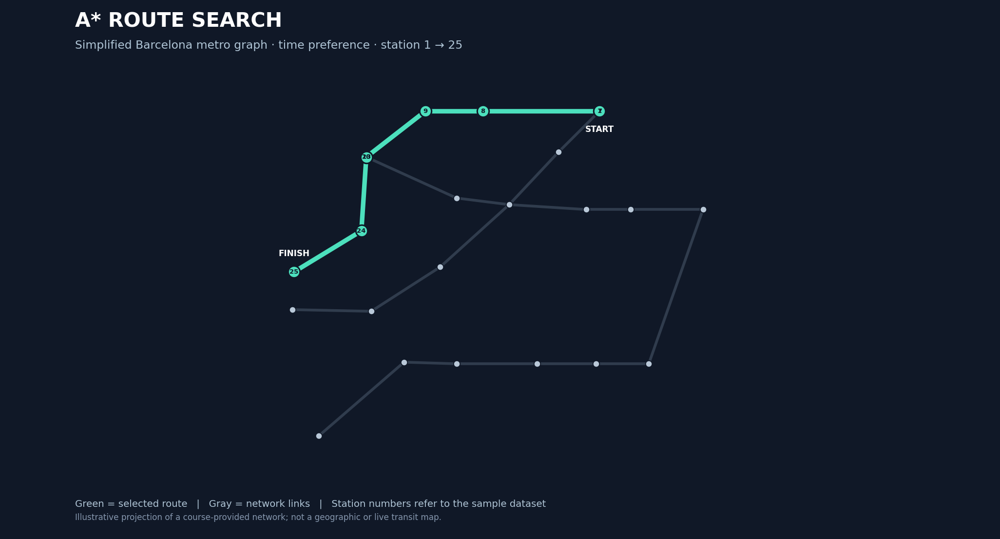

# Metro Route Search Algorithms | DFS, BFS, UCS & A*

**Graph search and route optimization with Python** — an Artificial Intelligence course project at the **Universitat Autònoma de Barcelona (UAB)** (2025–2026).

This project explores how classical search algorithms behave on simplified metro networks. It implements uninformed search, cost-based search, heuristic-guided A*, and a coordinate-based extension that allows walking to or from stations.

> **Academic project:** This is an algorithm implementation and demonstration, not a live metro navigation application. It uses teaching datasets rather than real-time transport information.



## Algorithms & features

| Algorithm | Search strategy | What the implementation explores |
| --- | --- | --- |
| **DFS** | Depth-first | Expands routes using a stack-like frontier |
| **BFS** | Breadth-first | Finds a route with the fewest graph edges in an unweighted network |
| **UCS** | Uniform-cost | Expands paths by accumulated cost `g(n)` |
| **A\*** | Heuristic-guided | Orders candidates using `f(n) = g(n) + h(n)` |
| **Coordinate-based A\*** | Walking + metro | Searches from start/end coordinates via virtual nodes and walking connections |

For UCS and A*, four cost preferences are implemented: **number of steps**, **travel time**, **distance**, and **transfers**. The project also includes cycle detection, redundant-route filtering and per-criterion heuristic functions.

## Quick start

**Requirements:** Python 3.10+ and NumPy. The included examples use only local files.

```bash
git clone https://github.com/jordi-tulleuda/metro-route-search-algorithms.git
cd metro-route-search-algorithms
python -m pip install -r requirements.txt
```

**1. List available station IDs**

```bash
python demo.py --city barcelona --list-stations
```

**2. Find an example A* route in the simplified Barcelona network**

```bash
python demo.py --city barcelona --algorithm astar --origin 1 --destination 25 --preference time
```

**3. Compare it with another search strategy**

```bash
python demo.py --city barcelona --algorithm bfs --origin 1 --destination 25
python demo.py --city barcelona --algorithm ucs --origin 1 --destination 25 --preference distance
```

**4. Try A* between coordinates** (the original coursework extension)

```bash
python demo.py --city lyon --algorithm astar-coordinates --origin-x 80 --origin-y 100 --destination-x 100 --destination-y 240
```

The coordinate values are those of the simplified teaching dataset, **not geographic latitude and longitude**.

## Example result

For the Barcelona command in step 2, the algorithm returns this station sequence:

```text
[1, 7, 8, 9, 10, 23, 24, 25]
```

This is a route in the **course-provided simplified network**. A different optimization criterion can produce a different route.

## Tests

Run the independent tests included in this repository:

```bash
python -m unittest discover -s tests -v
```

The original submitted solution passed **12/12 supplied coursework checks** locally; the teacher-provided test suite is deliberately not included in this public-facing portfolio edition. The additional tests in `tests/` demonstrate reproducible behavior and edge handling. See [implementation notes](docs/IMPLEMENTATION_NOTES.md) for the exact distinction.

## Repository structure

```text
metro-route-search-algorithms/
├── README.md
├── SearchAlgorithm.py           # Coursework graph-search implementation
├── SubwayMap.py                 # University-provided map and path classes
├── utils.py                     # University-provided data-loading helpers
├── demo.py                      # Portfolio command-line demonstration
├── requirements.txt
├── CityInformation/
│   ├── Barcelona_City/         # Simplified teaching dataset
│   └── Lyon_smallCity/         # Simplified teaching dataset
├── tests/test_routes.py         # Independent portfolio tests
├── assets/barcelona-example.png
└── docs/IMPLEMENTATION_NOTES.md
```

## Project context & attribution

- **Course:** Artificial Intelligence, Universitat Autònoma de Barcelona (UAB).
- **Academic year:** 2025–2026.
- **Nature of work:** university coursework; the division of contributions among collaborators has not been specified in this public version.
- **Scaffolding and data:** `SubwayMap.py`, `utils.py`, and the sample networks originated in the university teaching materials. The search-algorithm solution was produced during the coursework.
- **Portfolio additions:** runnable CLI, project documentation, diagram, independent tests and a defensive no-route adjustment.

This repository is for presenting the technical work and learning outcomes of the course. Redistribution of university teaching materials and collaborative work should be authorized before publishing the repository publicly.
